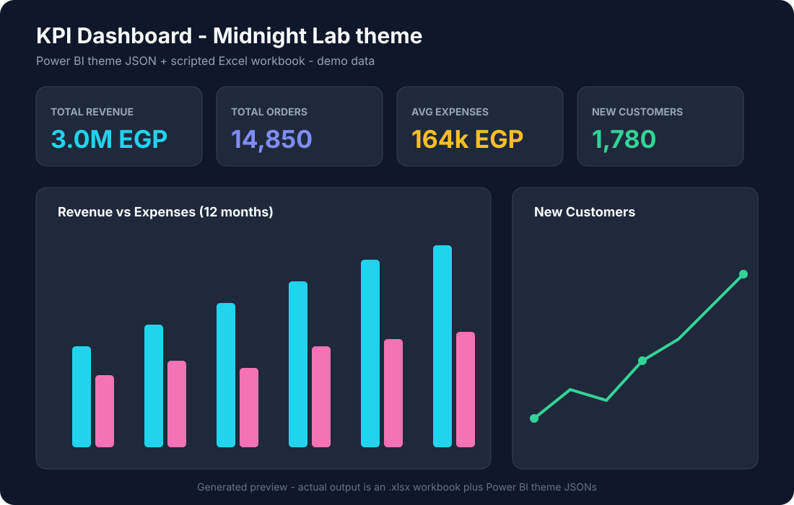

# Dashboard Lab

Free BI templates: two Power BI theme JSONs and a scripted Excel KPI dashboard, with generated preview images. No licenses, no paid tools - Excel/LibreOffice and free Power BI Desktop are enough.

## What's inside

- **`themes/midnight.json`** - dark "Midnight Lab" Power BI theme (colors, card backgrounds, rounded borders, typography).
- **`themes/daylight.json`** - light "Daylight Lab" Power BI theme for print-friendly reports.
- **`build_kpi_dashboard.py`** - builds `dist/kpi_dashboard.xlsx` (demo data, KPI cards, native Excel charts) with `openpyxl`. Save As `.xltx` to keep it as a reusable template.



## Quickstart

Power BI theme: View -> Themes -> Browse for themes -> pick a JSON from `themes/`.

Excel dashboard:

```bash
pip install openpyxl
python3 build_kpi_dashboard.py   # writes dist/kpi_dashboard.xlsx
```

## Files

| File | Purpose |
|------|---------|
| `themes/*.json` | Power BI theme files (official theme schema). |
| `build_kpi_dashboard.py` | Scripted Excel dashboard generator. |
| `docs/preview.svg` | Preview of the Midnight Lab look (generated). |

Free tools only: Power BI Desktop (free), openpyxl, any spreadsheet app that opens .xlsx.
